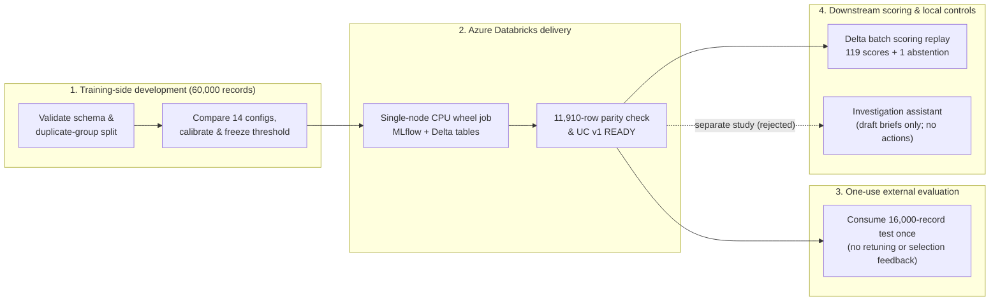

# Fleet Fault Triage

[](https://github.com/stefan-mcf/databricks-fleet-fault-triage/actions/workflows/checks.yml)

**Machine learning for routing recorded heavy-truck faults to the right review queue.**

When a truck fault is already recorded, a reviewer needs to decide whether it warrants an **Air Pressure System (APS)** specialist, belongs in general component review, or needs better data first. Fleet Fault Triage tests that decision on the public Scania benchmark. The project spans data preparation, model selection and calibration, a frozen external evaluation, and managed batch scoring on **Azure Databricks** with **MLflow**, **Unity Catalog** and **Delta Lake**.

On the frozen test, the classifier flagged **346 of 368 scored APS cases**. The same queue contained **310 other recorded faults**, making the cost of high recall visible. The system abstained on 128 incomplete records.

[Engineering case study](docs/case-study.md) · [Benchmark results](#measured-external-benchmark) · [Databricks implementation](docs/databricks.md) · [Run the demo](#run-the-synthetic-demo)

## The triage problem

The benchmark describes each recorded fault with 170 anonymised numeric predictors. A quality check runs before scoring, and eligible records are routed using a threshold chosen on training-side data.

| Review route | Decision |
| :--- | :--- |
| **APS review** | Refer an eligible record for specialist review when its calibrated score reaches the frozen threshold. |
| **Other fault review** | Route an eligible record below the threshold to general component review. |
| **Insufficient evidence** | Hold a record for input review when missing predictors exceed the training-derived 47.06% cutoff. Count it in coverage as an abstention. |

Both benchmark classes represent recorded faults. The data lacks vehicle identity, operating periods and time to failure, so the evidence applies to retrospective fault-family triage. [Method and limitations](docs/limitations.md)

## Scope and architecture

The training data was split by exact duplicate group. Separate partitions supported model fitting, calibration and threshold selection. The 16,000-record external test was reserved and used once after the recipe and threshold were frozen.



| Workstream | What was built and contributed | Representative code | Recorded evidence / demo |
| :--- | :--- | :--- | :--- |
| **Data contracts & splits** | Strict schema/numeric parsing, quarantine accounting, exact-duplicate `group_id` isolation across development/calibration/decision splits, and a 99th-percentile missingness cutoff | [data.py](src/fleet_fault_triage/data.py) · [contracts.py](src/fleet_fault_triage/contracts.py) | [Methodology](docs/methodology.md#data-and-partitioning) |
| **Model comparison & freeze** | 14 fixed configurations over 5 duplicate-group-aware folds, `HistGradientBoostingClassifier` selection, separate sigmoid calibration and threshold freeze on the decision partition | [model.py](src/fleet_fault_triage/model.py) | [Methodology](docs/methodology.md#model-selection-and-freeze) |
| **One-use external benchmark** | Hash-verified single-consumption reservation, scored-record metrics with 95% Wilson intervals, explicit abstention accounting and scored-row overlap verification | [evaluation.py](src/fleet_fault_triage/evaluation.py#L34) | [Benchmark extract](evidence/classifier-benchmark.json) |
| **Azure Databricks delivery** | Bounded single-node CPU wheel jobs, runtime workspace/principal guards, Delta `training`/`fit_attempts` mirroring, MLflow lineage, 11,910-row parity check and Unity Catalog v1 `READY` | [databricks.yml](databricks.yml) · [cloud.py](src/fleet_fault_triage/cloud.py#L282) · [cloud_tasks.py](src/fleet_fault_triage/cloud_tasks.py) | [Delivery extract](evidence/databricks-delivery.json) · [Databricks notes](docs/databricks.md) |
| **Governed Delta scoring** | Label-free feature-allowlist scoring, explicit abstention routing, managed Delta payload persistence and saved-payload hash readback under a serial scorer job | [cloud.py](src/fleet_fault_triage/cloud.py#L375) · [scoring.py](src/fleet_fault_triage/scoring.py) | [Scoring extract](evidence/delta-scoring.json) |
| **Lifecycle & local controls** | Idempotent batch commits, append-only hash-chained review corrections, gated promotion/rollback contracts and label-gated monitoring checks | [lifecycle.py](src/fleet_fault_triage/lifecycle.py) · [monitoring.py](src/fleet_fault_triage/monitoring.py) · [rehearsal.py](src/fleet_fault_triage/rehearsal.py) | [Synthetic demo](#run-the-synthetic-demo) |
| **Investigation assistant (separate)** | Bounded retrieval and deterministic-fact brief assembly evaluated on 40 outcomes per method; rejected on completeness failures and never given equipment-action authority | [investigation.py](src/fleet_fault_triage/investigation.py) | [Assistant status](evidence/assistant-status.json) · [Release decision](docs/case-study.md#the-release-decision) |

## Measured external benchmark

The benchmark measured classification on **15,872 scored records**. Coverage accounts for all 16,000 inputs, including the 128 abstentions.

| Metric | Result | Denominator / scope |
| :--- | ---: | :--- |
| **Scoring coverage** | **99.2%** | 15,872 scored of 16,000 input records (128 abstentions; 0 quarantined) |
| **Recall** | **94.02%** | 346 / 368 scored APS records (95% Wilson CI: 91.11%–96.02%) |
| **Precision** | **52.74%** | 346 / 656 scored records flagged for APS review (95% Wilson CI: 48.92%–56.54%) |
| **Average precision** | **0.9091** | 15,872 scored records |
| **Confusion counts (TP / FP / FN / TN)** | **346 / 310 / 22 / 15,194** | Sum = 15,872 scored records |
| **Exact-feature cross-file overlap** | **0 rows** | Checked across the 15,872 scored test records (128 unscored excluded) |


*Left: scored-record routing counts across 15,872 eligible records. Right: scored-record recall, precision (with 95% Wilson intervals) and average precision separated from 16,000-record input coverage.*


At this threshold, the benchmark produced about **1.9 review flags per correctly flagged APS case**. Another 22 scored APS cases fell into the other-fault route. [Methodology](docs/methodology.md) · [Benchmark evidence](evidence/classifier-benchmark.json)

## Databricks delivery and engineering controls

The frozen scikit-learn recipe ran on a single CPU node. Databricks handled job orchestration, tracking, registration and Spark/Delta persistence.

| Engineering control | Observed historical evidence | Inspect |
| :--- | :--- | :--- |
| **Training and registration** | Completed wheel job, MLflow run and dataset metadata, and Unity Catalog version 1 in `READY` state. | [Delivery evidence](evidence/databricks-delivery.json) · [Training code](src/fleet_fault_triage/cloud.py#L282) |
| **Prediction continuity** | Compared local and reloaded cloud model predictions on **11,910 records** before registration. Maximum absolute difference was **2.22e-16**. | [Delivery evidence](evidence/databricks-delivery.json) |
| **Delta scoring and readback** | Persisted **119 scores and one abstention** in a replay of training records, then read back and verified the saved payload. | [Scoring evidence](evidence/delta-scoring.json) · [Scoring code](src/fleet_fault_triage/cloud.py#L375) |
| **Execution and access controls** | Separate trainer, evaluator and scorer identities, bounded jobs and no automatic retries. | [Job bundle](databricks.yml) · [Task guards](src/fleet_fault_triage/cloud_tasks.py) |

The replay verified persistence and serial batch behaviour. The external benchmark supplies the model-quality results. Native promotion and rollback remain open. [Databricks implementation](docs/databricks.md) · [Registered model preservation](evidence/preservation.json)

## Separate assistant study: why it was rejected

The project also tested a retrieval-assisted tool for drafting investigation briefs. Both independent AI reviews found **18 of 25 answerable cases complete** for each retrieval method. The study rejected both methods because critical parts of answers were missing even when the facts and numbers they did provide were correct. The later candidate reached local testing only. [Release decision](docs/case-study.md#the-release-decision) · [Assistant evidence](evidence/assistant-status.json)

## Run the synthetic demo

Requires Python 3.12 and [uv](https://docs.astral.sh/uv/). Dependency installation requires internet access; the demo itself uses no network, cloud credentials, Scania data, fitted research model or language model.

```sh
git clone https://github.com/stefan-mcf/databricks-fleet-fault-triage.git
cd databricks-fleet-fault-triage
uv sync --locked --all-extras
make demo
make check
```

`make demo` runs [rehearsal.py](src/fleet_fault_triage/rehearsal.py) into a fresh timestamped folder under `outputs/`. It generates three explicitly synthetic cases covering `aps_review`, `other_fault_review` and `insufficient_evidence`, then verifies idempotent batch replay, label-column rejection, append-only hash-chained review correction across store reopen, stale-review rejection, denied promotion, local rollback, out-of-scope investigation denial and synthetic monitoring/FinOps outputs. These are **local synthetic controls**, not historical cloud execution, benchmark accuracy, native Unity Catalog promotion or human acceptance.

## Review in 2, 5 or 15 minutes

- **2 minutes:** scan the triage framing, figures and tables above, then read [limitations and stopping point](docs/limitations.md).
- **5 minutes:** read the [engineering case study](docs/case-study.md) and inspect [Databricks delivery](docs/databricks.md), [databricks.yml](databricks.yml) and [evidence provenance](evidence/provenance.json).
- **15 minutes:** run `make demo` and `make check`, then trace the implementation from [data.py](src/fleet_fault_triage/data.py) and [model.py](src/fleet_fault_triage/model.py) through [evaluation.py](src/fleet_fault_triage/evaluation.py), [cloud.py](src/fleet_fault_triage/cloud.py) and [lifecycle.py](src/fleet_fault_triage/lifecycle.py).

## Evidence, dataset notices and reuse

- **Source and evidence provenance:** The executable source preserves the **22-module Databricks scoring milestone** verbatim, with dependency-only security maintenance declared separately in [source-provenance.json](evidence/source-provenance.json). Public files under `evidence/` are allowlisted aggregate extracts indexed with source revisions, hashes and redactions in [provenance.json](evidence/provenance.json); withheld private records are not independently re-checkable from hashes alone, and no platform screenshots or live services have been fabricated.
- **Dataset attribution and notices:** Scania CV AB / UCI, [APS Failure at Scania Trucks](https://archive.ics.uci.edu/dataset/421/aps+failure+at+scania+trucks), DOI [10.24432/C51S51](https://doi.org/10.24432/C51S51). Raw records, row-level derivatives, fitted weights and bundled model examples are excluded. The UCI page lists a CC BY 4.0 declaration and reproduces an older GPL v3-or-later donor notice; both are recorded without claiming one cancels the other—see [limitations](docs/limitations.md) and [methodology](docs/methodology.md#dataset-notices).
- **Licence and citation:** Original code remains **all rights reserved** and is published for portfolio inspection rather than under an open-source licence. See [LICENSE.md](LICENSE.md), [snapshot status](docs/snapshot-status.md) and [CITATION.cff](CITATION.cff).
