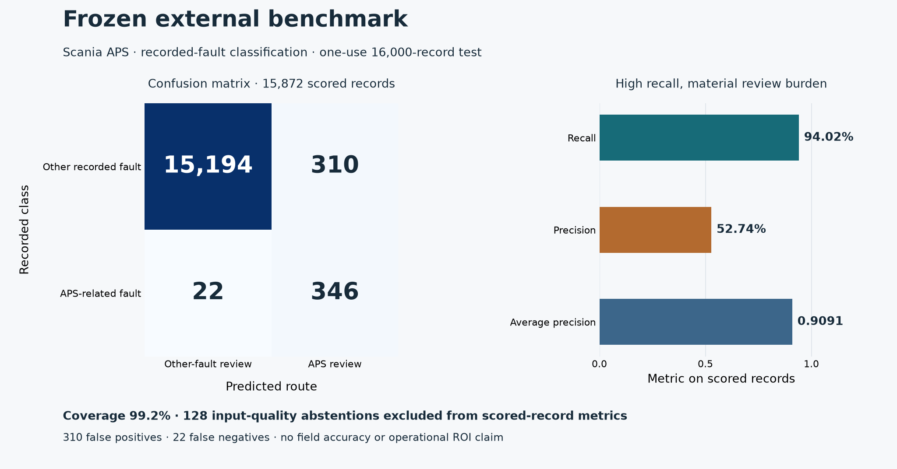
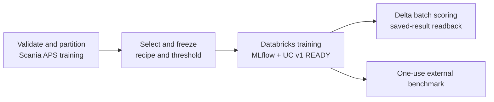

# Fleet Fault Triage

### Databricks ML delivery for recorded truck-fault classification

[](https://github.com/stefan-mcf/databricks-fleet-fault-triage/actions/workflows/checks.yml)

A frozen classifier executed on **Azure Databricks**, tracked with **MLflow**, registered in **Unity Catalog**, and used to persist **Delta** scoring results. This repository connects the implementation to dated evidence, exposes the limitations, and provides a synthetic demo that runs without cloud credentials.

**Portfolio research snapshot · 24 November 2026 · Stefan McFeeters**

The classifier benchmark and controlled cloud workflow are complete. Production deployment and the supporting language-model assistant were not accepted. The research is closed for now, with those boundaries preserved.

## What was measured

The Scania APS benchmark classifies recorded APS-related faults against other recorded component faults. It does not identify healthy trucks or establish advance warning of a future failure.

| Frozen external benchmark | Result |
| :--- | ---: |
| Recall on scored records | **94.02%** |
| Precision on scored records | **52.74%** |
| Average precision on scored records | **0.9091** |
| Coverage | **99.2%** |
| Scored / input-quality abstentions | **15,872 / 128** |
| True positives / false positives / false negatives / true negatives | **346 / 310 / 22 / 15,194** |

The threshold was frozen before the separate 16,000-record test was consumed once. The **310 false positives** are a real review burden, and the 128 abstentions are outside the scored-record metric denominators. [Benchmark evidence](evidence/classifier-benchmark.json) · [Methodology](docs/methodology.md)



## Databricks evidence

| Implemented and observed | Inspect |
| :--- | :--- |
| Completed training job; MLflow run and dataset metadata; Unity Catalog version 1 `READY` | [Delivery evidence](evidence/databricks-delivery.json) · [Training implementation](src/fleet_fault_triage/cloud.py#L282) |
| Local/cloud predictions compared across **11,910 records**, maximum absolute difference **2.22e-16** | [Parity evidence](evidence/databricks-delivery.json) |
| Managed Delta batch persisted **119 scores and one abstention**, with saved-payload readback | [Scoring evidence](evidence/delta-scoring.json) · [Delta write/readback implementation](src/fleet_fault_triage/cloud.py#L375) |
| Separate trainer/evaluator/scorer identities; bounded jobs; no automatic task retries | [Databricks bundle](databricks.yml) · [Task guards](src/fleet_fault_triage/cloud_tasks.py) |
| Input-quality abstention, append-only review correction and rejected local promotion | [Synthetic demo](#run-the-synthetic-demo) · [Lifecycle implementation](src/fleet_fault_triage/lifecycle.py) |

Training used **single-node scikit-learn on Databricks**, with Spark/Delta persistence. This is not a distributed-training, feature-store or live-serving demonstration. The 120-record scoring replay used training-partition records and is workflow proof, not another independent quality test.



[Databricks implementation and boundaries](docs/databricks.md) · [Case study and tradeoffs](docs/case-study.md)

The executable source is the preserved **22-module Databricks scoring milestone**. Dependency-only maintenance is declared separately from that historical environment. Later assistant research remains in the private archive and the documented failure analysis.

## Review in 2, 5 or 15 minutes

- **2 minutes:** read the results and evidence table above, then [what remains unproven](docs/limitations.md).
- **5 minutes:** inspect the [case study](docs/case-study.md), [evidence provenance](evidence/provenance.json), and [job bundle](databricks.yml).
- **15 minutes:** run the demo and tests, then follow the code from [data preparation](src/fleet_fault_triage/data.py) through [model selection](src/fleet_fault_triage/model.py), [cloud execution](src/fleet_fault_triage/cloud.py) and [persisted lifecycle state](src/fleet_fault_triage/lifecycle.py).

## Run the synthetic demo

Requires Python 3.12 and [uv](https://docs.astral.sh/uv/). Dependency installation needs internet; the demo itself uses no network, cloud account, benchmark data, fitted research model or language model.

```sh
git clone https://github.com/stefan-mcf/databricks-fleet-fault-triage.git
cd databricks-fleet-fault-triage
uv sync --locked --all-extras
make demo
make check
```

The demo creates three explicitly synthetic cases: an APS-review route, an other-fault route and an input-quality abstention. It also checks idempotent scoring, an append-only correction followed by store-reopen readback, a denied promotion and local rollback. The command prints the output directory for the generated report and JSON manifest. These are **local synthetic controls**, not native Unity Catalog lifecycle acceptance or new benchmark results.

The public checks exercise the selected tests shipped here. Current CI reports this curated package's result. [Source provenance](evidence/source-provenance.json) identifies the inspected implementation and its declared packaging changes.

## The assistant was rejected

A retrieval-assisted investigation extension was evaluated separately. The latest executed development candidate saved 40 outcomes per retrieval method, but both independent AI inventories rejected both methods: answerable completion was **18/25 (72%)**, with critical response failures. Factual support and exact numbers did not compensate for incomplete answers.

A later candidate passed local checks but was not hosted-evaluated. It is not presented as a working production assistant. [Recorded outcome](evidence/assistant-status.json) · [Release decision](docs/case-study.md#the-release-decision)

## Evidence and reuse

Public evidence files are declared extracts of preserved research records. Their provenance identifies the source revisions, hashes and omitted fields. Some underlying native records remain private; a hash does not make withheld evidence independently inspectable. No platform screenshot or live service has been fabricated for this showcase.

Scania CV AB / UCI: [APS Failure at Scania Trucks](https://archive.ics.uci.edu/dataset/421/aps+failure+at+scania+trucks), DOI [10.24432/C51S51](https://doi.org/10.24432/C51S51). Raw data, row-level derivatives, fitted weights and bundled model examples are excluded. The source carries both a CC BY 4.0 declaration and an older GPL donor notice; see [data and model limitations](docs/limitations.md).

Original code remains **all rights reserved**, available here for public inspection rather than under an open-source licence. [Licence and third-party notices](LICENSE.md) · [Snapshot status](docs/snapshot-status.md)
