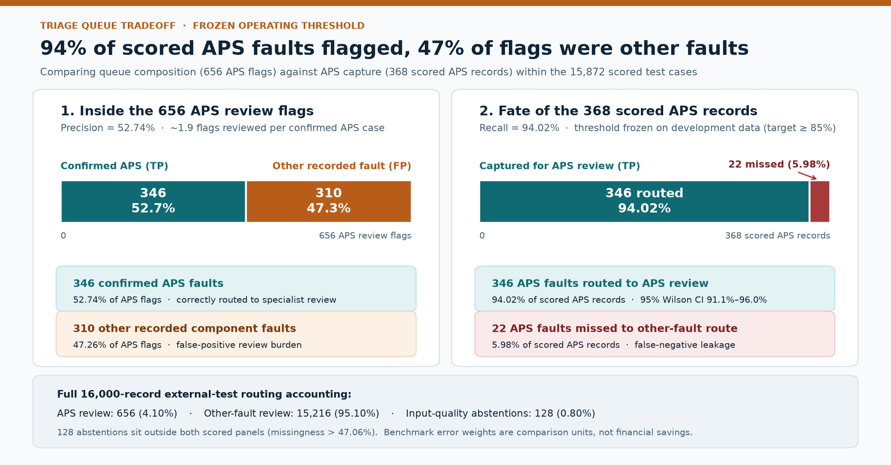

# Fleet Fault Triage: Engineering Case Study

This case study documents a self-directed ML engineering project: taking a recorded heavy-truck fault classifier beyond exploratory notebooks into a hash-bound training, evaluation and **Azure Databricks** delivery workflow, verifying what was registered and persisted, and enforcing an honest release gate when a supporting language-model extension failed. It uses a public benchmark (Scania Air Pressure System), not employer fleet data.

## The triage scenario and problem boundary

In a heavy-truck maintenance review workflow, recorded fault cases do not arrive clean or evenly balanced. Some records relate to the **Air Pressure System (APS)**—where missed cases carry a high review penalty—while the vast majority belong to other component faults, and a small fraction arrive with too many missing predictors to score responsibly.

The intended application contract ([contracts.py](../src/fleet_fault_triage/contracts.py), [scoring.py](../src/fleet_fault_triage/scoring.py)) maps each recorded fault case to one of three explicit review routes:

1. **`aps_review`** — calibrated APS probability at or above the frozen operating threshold (`0.027641`).
2. **`other_fault_review`** — scored below threshold and routed to general component-fault review.
3. **`insufficient_evidence`** — abstained because the record's missing-feature fraction exceeds the training-derived quality cutoff (`0.47058823529411764`, or 47.06% of the 170 predictors) or all predictors are missing.

This framing enforces three non-negotiable domain boundaries:

- **Recorded fault-family routing, not healthy-truck screening.** In the Scania APS dataset, negative (`neg`) cases are other recorded component faults rather than healthy vehicles. There is no healthy-fleet denominator, no vehicle identifier, no operating-period metadata and no measurement-to-failure lead time. Calling the classifier "predictive maintenance" or claiming advance failure warning would fabricate evidence the benchmark cannot supply.
- **Explicit abstention over silent imputation.** Tree-based models can emit a score even when most predictors are absent. Letting severely degraded inputs enter scored accuracy metrics conceals input-quality failure; routing them to `insufficient_evidence` keeps coverage and abstentions visible together.
- **Design intent versus operational claims.** Describing how a review queue could act on `aps_review` versus `other_fault_review` states engineering intent only. The project establishes no field deployment, workshop acceptance or measured financial savings; the Scania benchmark's false-positive (`10`) and false-negative (`500`) weights are comparison units, not Australian dollars.

## Status by workstream

Keeping distinct evidence tiers separate prevents a local control test or a rejected research branch from blurring what was actually verified in the cloud.

| Workstream | Status at stopping point | Evidence tier | Primary record |
| :--- | :--- | :--- | :--- |
| **Data contracts & duplicate-group splits** | Complete; 0 exact-duplicate groups crossing internal splits | Verified source + local tests | [data.py](../src/fleet_fault_triage/data.py) · [methodology.md](methodology.md) |
| **Model selection, calibration & freeze** | Complete; 14 configs compared, HGB + sigmoid frozen | Historical local development (82 fits incl. failures) | [model.py](../src/fleet_fault_triage/model.py) · [databricks-delivery.json](../evidence/databricks-delivery.json) |
| **One-use external benchmark** | Complete; 16,000-record test consumed once, gates passed | Historical one-shot evaluation (`2026-10-27`) | [classifier-benchmark.json](../evidence/classifier-benchmark.json) |
| **Azure Databricks training & UC registration** | Complete; MLflow run, Delta tables, 11,910-row parity, UC v1 `READY` | Historical cloud execution + SDK projections (`2026-10-27`) | [databricks-delivery.json](../evidence/databricks-delivery.json) · [databricks.md](databricks.md) |
| **Managed Delta scoring replay** | Complete; 119 scores + 1 abstention persisted and read back | Historical training-record workflow replay (`2026-10-29`) | [delta-scoring.json](../evidence/delta-scoring.json) |
| **Registered model preservation** | Complete; 12-file export and private recovery hashes verified | Attributed preservation summary (`2026-11-05`) | [preservation.json](../evidence/preservation.json) |
| **Supporting investigation assistant** | **Rejected**; latest executed candidate failed completeness (18/25) | Historical dev run + two separate AI inventories (`2026-11-11`) | [assistant-status.json](../evidence/assistant-status.json) · [#the-release-decision](#the-release-decision) |
| **Later assistant candidate** | Unexecuted in hosted environment | Local/source checks only | [snapshot-status.md](snapshot-status.md) |
| **Local synthetic rehearsal & public CI** | Passing on curated 22-module snapshot | Local synthetic controls only | [rehearsal.py](../src/fleet_fault_triage/rehearsal.py) · [source-provenance.json](../evidence/source-provenance.json) |
| **Native promotion/rollback & human acceptance** | Incomplete / deferred | Not established | [limitations.md](limitations.md) |

## Data contracts, partitions and model freeze

The Scania APS training file contains 60,000 records (1,000 positive APS cases and 59,000 other recorded faults) across 170 anonymised numeric predictors. Before any model fitting, [data.py](../src/fleet_fault_triage/data.py#L96-L193) validates headers and numeric types, quarantines malformed/all-missing/label-conflicting rows with full input conservation, hashes canonical float rows into exact-feature `group_id` values (explicitly noting that exact feature duplicates are not vehicle IDs), and splits the accepted training rows with `StratifiedGroupKFold(n_splits=10, shuffle=True, random_state=42)` so no duplicate group crosses internal partition boundaries.

| Partition | Source records | Eligible for scoring | Quality abstentions | Role in workflow |
| :--- | ---: | ---: | ---: | :--- |
| **Development** | 42,000 | 41,677 | 323 | Fit 14 fixed configurations across 5 duplicate-group folds; derive 99th-percentile missingness cutoff (`0.47058823529411764`) |
| **Calibration** | 6,000 | 5,949 | 51 | Fit post-hoc sigmoid calibration (`CalibratedClassifierCV` over `FrozenEstimator`) without refitting base trees |
| **Decision** | 12,000 | 11,910 | 90 | Select and freeze operating threshold (`0.027640664097107016`); generate 11,910-row local/cloud parity reference |
| **External test (sealed)** | 16,000 | 15,872 | 128 | Consumed **once** after freeze and cloud parity verification; never fed model or threshold selection |

Four concrete modelling decisions shaped the frozen recipe ([model.py](../src/fleet_fault_triage/model.py#L51-L328)):

1. **Bounded hypothesis space.** Fourteen fixed configurations—6 median-imputed, scaled `LogisticRegression` models and 8 native-missingness `HistGradientBoostingClassifier` models—were compared across 5 duplicate-group-aware folds, computing each fold's missingness limit on `fold_train` only so validation rows never influenced quality cutoffs.
2. **Separate calibration and threshold search.** The selected histogram gradient boosting configuration used a 0.1 learning rate, 31 leaves, 200 iterations and balanced class weights. Sigmoid calibration used 5,949 eligible calibration rows with the base estimator frozen. The decision partition supplied 11,910 eligible rows. Threshold search kept ties together and minimised benchmark cost (`10 * FP + 500 * FN`) subject to recall ≥ 85%. Coverage ≥ 95% was a separate development gate. [Threshold and gates](../src/fleet_fault_triage/model.py#L122-L157)
3. **Model-family selection.** The tree had to pass the development gates. The selection rule then accepted it if the upper bound of a 2,000-replicate paired group bootstrap fell below zero for its cost difference versus logistic regression, or if logistic regression failed its own gates. [Selection rule](../src/fleet_fault_triage/model.py#L314-L328)
4. **Fit accounting and transparency.** The historical fit ledger records **84** real-data fit operations (82 local, including failed attempts, plus 2 cloud fits for base estimator and calibrator). Not all original per-fold comparison scores were retained; recovered configuration means are disclosed rather than presented as complete historical fold logs.

## Measured external benchmark and review tradeoff

The Databricks task recorded the test hash in a Delta reservation table under a serial evaluator job. The evaluation implementation also reserved the hash in its local store before parsing test rows. An interruption left those reservations in place. [Databricks task](../src/fleet_fault_triage/cloud_tasks.py#L90-L110) · [External evaluation](../src/fleet_fault_triage/evaluation.py#L34-L137)

| Frozen external-test metric (`2026-10-27`) | Observed value | Denominator / boundary |
| :--- | ---: | :--- |
| Input records / quarantined rows | **16,000 / 0** | Complete Scania APS test file |
| Scored records / input-quality abstentions | **15,872 / 128** | Coverage = **99.2%** (`15,872 / 16,000`) |
| True positives / false negatives | **346 / 22** | 368 scored APS-related fault records |
| False positives / true negatives | **310 / 15,194** | 15,504 scored other-component fault records |
| Recall on scored records | **94.02%** | `346 / 368` (95% Wilson CI: 91.11%–96.02%) |
| Precision on scored records | **52.74%** | `346 / 656` (95% Wilson CI: 48.92%–56.54%) |
| Average precision on scored records | **0.9091** | `15,872` scored records |
| Cross-file exact-feature overlap | **0 rows** | Verified on `15,872` scored rows (`evaluation.py#L62-L63`, `#L82-L83`); 128 abstentions excluded |

*Complementary confusion-matrix and confidence-interval view: [benchmark.png](../assets/benchmark.png) · Raw aggregate extract: [classifier-benchmark.json](../evidence/classifier-benchmark.json).*

The queue-level numbers tell a much sharper engineering story than aggregate ranking metrics alone:

- **The 656 APS review flags contained 346 APS faults and 310 other recorded component faults.** That is about 1.9 flags per correctly flagged case. Applying the same routing in a workshop would require its own review-capacity evaluation.
- **22 of 368 scored APS faults (5.98%) still routed to `other_fault_review`**, and **128 records (0.80% of 16,000)** routed to `insufficient_evidence` because missing predictors exceeded 47.06%. Scored-record recall and precision do not apply to those 128 unscored cases.

## Key engineering decisions and Databricks delivery

Executing the frozen classifier on Azure Databricks was designed around verifiable continuity and blast-radius bounds rather than cluster scale.

| Engineering decision | Why it mattered | Implementation | Verified evidence |
| :--- | :--- | :--- | :--- |
| **Single-node CPU Databricks wheel jobs** | 60k × 170 tabular data does not need distributed tree training; Databricks adds orchestration, governance, MLflow and Delta persistence | [databricks.yml](../databricks.yml) (`Standard_E4ds_v6`, `num_workers: 0`, `max_concurrent_runs: 1`, `max_retries: 0`, 1,800s/900s timeouts) | Training & scoring jobs `TERMINATED` / `SUCCESS` ([databricks-delivery.json](../evidence/databricks-delivery.json), [delta-scoring.json](../evidence/delta-scoring.json)) |
| **Runtime workspace, permit & principal checks** | Local config alone can point at the wrong workspace or identity; runtime jobs must self-verify against provider APIs | [cloud_tasks.py](../src/fleet_fault_triage/cloud_tasks.py#L18-L65) (`X-Databricks-Org-Id` header check + `current_user.me()` role binding) | Trainer/evaluator/scorer separation and allowed/denied storage probes recorded ([databricks-delivery.json](../evidence/databricks-delivery.json)) |
| **Delta mirroring & fit-budget ledger before fitting** | Interrupted runs must neither silently mutate training inputs nor hide consumed cloud fits | [cloud.py](../src/fleet_fault_triage/cloud.py#L295-L326) (hash check on Parquet, full content comparison against Delta `training`, pre-fit reservation in `fit_attempts`) | Managed Delta `training` (175 cols) and `fit_attempts` (2 cols) verified; 2 cloud fits logged (84 total) |
| **11,910-row local/cloud parity & reload readback** | A successful MLflow `log_model` call does not prove numeric continuity across environments or serialization | [cloud.py](../src/fleet_fault_triage/cloud.py#L347-L362) (`skops` serialization, 170 `double` signature, `mlflow.pyfunc.load_model` reload check before UC registration) | Max absolute diff **`2.22e-16`** across 11,910 rows (tolerance `1e-6`); UC model version 1 `READY` |
| **Governed Delta scoring & payload readback** | A write returning without error does not confirm what landed in Delta or protect serial batch replays from silent drift | [cloud.py](../src/fleet_fault_triage/cloud.py#L375-L419), [scoring.py](../src/fleet_fault_triage/scoring.py) (`batch_id`, `payload`, `output_hash` reread and re-hashed) | Training-record replay persisted **119 scores + 1 abstention** (120 rows) with verified payload readback ([delta-scoring.json](../evidence/delta-scoring.json)) |
| **Append-only review chains & release gates** | Overwriting review state destroys auditability; promotion must fail closed when any gate or approval is missing | [lifecycle.py](../src/fleet_fault_triage/lifecycle.py#L117-L205) (`previous_event_hash` chain + four required boolean release gates) | Verified in unit tests and local synthetic rehearsal ([rehearsal.py](../src/fleet_fault_triage/rehearsal.py)) |
| **Separate model preservation & AST provenance** | Public portfolio packaging must keep raw rows and weights private while proving the shipped source matches key cloud functions | [source-provenance.json](../evidence/source-provenance.json), [preservation.json](../evidence/preservation.json) | `train_registered` and `score_delta` Python 3.12 AST hashes match recorded execution revisions; private UC export hash-verified |

**Explicit Databricks boundaries:**

- Fitting was single-node scikit-learn on Pandas data with Spark/Delta persistence—not distributed training, a feature store or live managed model serving.
- Numeric parity (`2.22e-16` max difference across 11,910 rows) confirms prediction continuity within the `1e-6` tolerance, not bitwise artifact identity or universal ULP equivalence across platforms.
- MLflow's logged Delta datasource `read_version: 0` is associated lineage evidence, not an explicitly verified `VERSION AS OF` time-travel pin or current-history query.
- `score_delta` enforces a serial-job idempotency contract (`max_concurrent_runs: 1`), not concurrency-safe exactly-once writes under arbitrary concurrent external writers, and the 120-row replay used training-partition inputs (workflow proof only).
- Unity Catalog version 1 `READY` establishes a registered research model with designated ownership and consumer grants, not native champion promotion, rollback acceptance or production operation.

For job definitions, SQL grants and full cloud mechanics, see [databricks.md](databricks.md).

## The release decision

The clearest engineering judgment in this project was rejecting the supporting investigation-assistant extension rather than softening its release gate.

The assistant ([investigation.py](../src/fleet_fault_triage/investigation.py)) was designed to sit strictly downstream of persisted scores, retrieving approved runbooks and assembling structured draft investigation briefs while keeping deterministic scores and limitations immutable and prohibiting any write to human review state or equipment controls.

In the latest executed development study (`2026-11-11`, [assistant-status.json](../evidence/assistant-status.json)), both keyword and hybrid retrieval methods produced **40 saved outcomes** each (31 model responses, 9 application fallbacks, 0 provider blocks). Two independent complete AI inventories evaluated all 80 saved outcomes and both rejected both methods:

| Independent AI inventory | Retrieval method | Answerable completion | Critical required-response failures | Supported / all facts | Supported / all cited facts |
| :--- | :--- | ---: | ---: | ---: | ---: |
| **Inventory A** | Keyword | **18 / 25 (72%)** | **9** | 1,242 / 1,242 | 396 / 396 |
| **Inventory A** | Hybrid | **18 / 25 (72%)** | **8** | 1,253 / 1,253 | 401 / 401 |
| **Inventory B** | Keyword | **18 / 25 (72%)** | **8** | 1,278 / 1,278 | 422 / 422 |
| **Inventory B** | Hybrid | **18 / 25 (72%)** | **8** | 1,307 / 1,307 | 430 / 430 |

Inventories A and B remain separate—their differing claim counts and failure tallies are neither pooled nor averaged, and neither inventory substitutes for independent human acceptance. Crucially, across every method and inventory, **zero numeric-identity or material source errors were observed** and every checked fact was source-supported, yet both methods failed because **7 of 25 answerable cases remained incomplete** with critical required-response omissions.

Two practical lessons followed directly from this gate:

1. **Groundedness and exact numbers do not guarantee task completion.** An assistant that never hallucinates a probability or citation can still fail an operator by omitting required parts of an answerable response. Keeping the 85% completion and zero-critical-failure release criteria ([evaluation.py](../src/fleet_fault_triage/evaluation.py#L215-L220)) intact prevented an attractive grounding score from masking an incomplete workflow.
2. **Isolating workstream acceptance preserved the verified classifier milestone.** Because the assistant never qualified for the untouched sealed evaluation (`retained_SEALED_outcomes_executed: 0`) and a later locally tested candidate remained unexecuted when research stopped, the project recorded an explicit rejection rather than bundling an unproven assistant into the Databricks classifier record. In addition, zero controlled retrieval payloads reached generation (`0` exposed), so no prompt-injection resistance claim is made.

## What the local synthetic demo proves—and does not prove

Running `make demo` executes [rehearsal.py](../src/fleet_fault_triage/rehearsal.py) without network access, cloud credentials, Scania records, fitted research weights or an LLM. In a fresh directory under `outputs/`, it verifies:

- **Three routing paths** on synthetic inputs: `aps_review`, `other_fault_review` and `insufficient_evidence`.
- **Contract enforcement:** identical batch replay returns identical outputs, while injecting a `label` column into scoring inputs raises a `ValueError`.
- **Persisted lifecycle state:** an append-only review correction links via `previous_event_hash` and survives reopening `cases.sqlite`; stale-hash reviews are rejected; promotion fails when any release gate is `False`; local alias rollback restores the previous release.
- **Bounded investigation and monitoring contracts:** out-of-scope case reads raise `PermissionError`; synthetic input-drift, delayed-label and FinOps ledgers emit explicitly labelled `synthetic_rehearsal` artifacts.

This rehearsal proves that the shipped application contracts behave deterministically on local storage. It does **not** reproduce the Scania benchmark metrics, contact Azure Databricks, verify native Unity Catalog alias promotion or supply human acceptance.

## What a future phase would establish

This portfolio snapshot closes the current research phase without scheduling cloud runs, retraining or held-out reuse. Reopening the project under fresh scope and authority would focus on four concrete gaps:

1. **Version-pinned Delta reproduction:** execute and verify explicit `VERSION AS OF` Delta reads with recorded table-history checks rather than relying on associated MLflow datasource metadata.
2. **Native Unity Catalog lifecycle proof:** run an explicitly approved native promotion, rejection and rollback cycle with saved-state provider readback.
3. **Human-reviewed assistant evaluation:** obtain independent human evaluation of hosted assistant outputs on an eligible development candidate before touching any sealed evaluation suite, while keeping original cohort boundaries intact.
4. **Operationally grounded telemetry:** evaluate on a dataset with established vehicle identities, maintenance timestamps and healthy-fleet denominators before making any advance-warning, field-generalisation or review-economics claim.

Related documentation: [Methodology](methodology.md) · [Databricks delivery](databricks.md) · [Limitations](limitations.md) · [Snapshot status](snapshot-status.md) · [Licence and dataset notices](../LICENSE.md).
