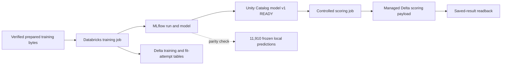

# Databricks delivery

This project used Azure Databricks to execute a frozen scikit-learn recipe, track it in MLflow, register a Unity Catalog model and persist scoring results in Delta. The fitting workload was single-node CPU work on Pandas data, with Spark/Delta used for persistence. It was not distributed model training.

## Recorded execution path

The [delivery evidence](../evidence/databricks-delivery.json) and [scoring evidence](../evidence/delta-scoring.json) record the historical executions. The diagram describes that verified path, not a continuously running service.

## Inspect the implementation

| File | What to inspect |
| --- | --- |
| [databricks.yml](../databricks.yml) | Wheel jobs, explicit runtime principals, bounded compute, task timeouts and zero retries |
| [cloud_tasks.py](../src/fleet_fault_triage/cloud_tasks.py) | Configuration/permit binding, runtime workspace and principal checks, task-specific entry points |
| [cloud.py](../src/fleet_fault_triage/cloud.py) | Frozen recipe verification, MLflow/Unity Catalog registration and Delta scoring readback |
| [model.py](../src/fleet_fault_triage/model.py) | Estimators, calibration, signature and safe serialization |
| [bootstrap.sql](../resources/bootstrap.sql) | Catalog/schema setup and declared identity boundaries |
| [registry-grants.sql](../resources/registry-grants.sql) | Model ownership and consumer privileges |

The public source is a curated research snapshot. [Provenance](../evidence/provenance.json) identifies the original source revisions; current package code is not relabelled as the exact historical job payload.

The [source manifest](../evidence/source-provenance.json) also compares `train_registered` and `score_delta` against their recorded execution revisions. Both function syntax trees match. This connects the inspectable implementation to the older source without claiming equivalence of every dependency or a new cloud execution.

## Training and model continuity

The training task uses the frozen recipe and verifies the prepared training and parity artifacts against the hashes declared in it. It records the recipe's digest; that is not a separate runtime authentication of the recipe against an independently approved hash. The task mirrors the prepared data to Delta and compares the table's contents against the verified bytes before fitting. A persisted fit-attempt table reserves the two cloud fit operations before execution, preserving accounting for failed or interrupted attempts.

MLflow logs the frozen recipe, source and dependency identities, split identity, threshold, training input association and parity metric. The task fits the base estimator on development records and sigmoid calibration on the separate calibration partition. It checks predictions against the frozen local reference, saves the model, reloads it, and checks predictions again before registration.

The historical readback verified Unity Catalog version 1 in `READY` state and its association with the original training run. The model signature has 170 double-valued inputs and a two-column output; the recorded serialization format is `skops`. Registration establishes a versioned research artifact. It does not establish an approved production champion or production serving.

MLflow's logged Delta datasource read-version is associated lineage evidence. The saved evidence does **not** establish an explicit `VERSION AS OF` pin, a current-history query or a time-travel reproduction. The verified prepared Parquet, its Delta content comparison and the numeric parity check are the demonstrated continuity controls.

## Scoring persistence

The scorer validates input and release identity, then stores a batch payload and its hash in a managed Delta table. Under the declared serial scorer job, replaying an identical batch returns the same result; a changed input/release/output identity is rejected. The implementation rereads the saved payload and recomputes its identity before returning success. This is a serial-job contract, not a claim of concurrency-safe exactly-once processing for arbitrary external writers.

The recorded replay persisted 120 cases: 119 model scores and one input-quality abstention. Saved local cases were also read back. These inputs came from the training partition, so this result demonstrates operational workflow, not a new independent accuracy test.

## Jobs and access boundaries

The bundle declares separate training, one-shot evaluation, scoring and monitoring jobs. Each permits one concurrent run and no automatic task retries. The CPU job cluster is single-node and policy-bound. Training/evaluation have 1,800-second timeouts; scoring/monitoring have 900-second timeouts. A YAML job definition alone does not prove its execution: historical training, evaluation and scoring have receipts; native monitoring acceptance remains unestablished.

The bundle's `mode: production` is a Databricks deployment-mode setting, not evidence that the study operated a production service.

Runtime tasks verify the actual workspace response and expected principal, rather than relying only on local configuration. Governance readback recorded designated model ownership, separate runtime identities, evaluator/scorer model-consumer grants, and both allowed and denied access probes. These bounded results do not establish enterprise IAM coverage or production security certification.

The [preservation receipt](../evidence/preservation.json) records a hash-verified export of the registered model and private off-device recovery checks. Those private weights, examples and cloud identifiers are excluded from this public package. Native promotion/rollback and a completed production lifecycle remain deferred.

## Review without cloud access

Use the repository's local synthetic demo and focused test suite to inspect contracts, persisted readback, rejection paths and local review/lifecycle behaviour. Those checks use synthetic data and are labelled accordingly. The bundle and configuration templates are reference implementation: cloning the repository grants no cloud access, spending authority or completed deployment.

The platform concepts follow the official documentation for [Unity Catalog model lifecycle](https://learn.microsoft.com/en-us/azure/databricks/machine-learning/manage-model-lifecycle/) and [MLflow on Azure Databricks](https://learn.microsoft.com/en-us/azure/databricks/mlflow/). Those references explain platform capabilities; the project claims only the narrower behaviours supported by its receipts. See [methodology](methodology.md) and [limitations](limitations.md).
